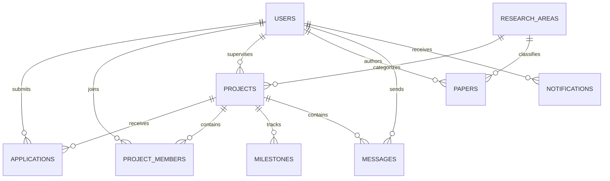

# CollabX — Research & Innovation Collaboration Portal

> **Motto:** *Discover · Connect · Collaborate*  
> **Tagline:** *Research Ideas · Connect People · Build the Future.*  
> **Course:** CSE 222 (DBMS Sessional), Port City International University (PCIU)

CollabX is a centralized university web portal where **students, researchers, and supervisors** discover research areas and open thesis opportunities, apply and participate, collaborate in interactive laboratory workspaces, publish research manuscripts, and receive intelligent machine learning recommendations.

---

## 1. Authentication & Role-Based Access Control

CollabX authenticates university students, researchers, and faculty supervisors directly via Firebase (Authentication & Cloud Firestore):

- **Self-Service Registration:** New students, researchers, and faculty create their accounts using their university credentials on the Sign Up page.
- **OAuth Providers:** Google and GitHub academic sign-in are supported via Firebase Authentication popup.
- **Admin Access:** Administrator privileges (`role: "admin"`) are strictly managed server-side and assigned via Firebase Console or designated Firestore security rules.

## 2. 20 Visual Screens Checklist

CollabX is faithfully designed to match all 20 reference screenshots:

- [x] **Page 1 — Home / Landing:** Full-width hero with dark glass card, 3-line heading, pill search, and overlapping stats bar (500+ Projects, 50+ Areas, 1000+ Scholars, 10+ Depts).
- [x] **Page 2 — Research Areas:** 4×2 pastel grid (AI, Data Science, Cyber Security, Web Tech, IoT, Cloud, Bioinformatics, Others) with live project counts and subfield tags.
- [x] **Page 3 — Projects List:** Left filter panel (Area, Type, Skills, Status, Apply Filters button) + Right sortable rows with 140×105 thumbnails, supervisor info, seats, and deadlines.
- [x] **Page 4 — Project Details:** Top-right banner, supervisor card with Contact/View Profile, tabs (Overview, Requirements, Team, Progress, Discussion, Files), 4 info cards, orange "Apply to Join" button with CV upload.
- [x] **Page 5 — Login:** Split view with academic artwork, email/password, and Google/GitHub authentication.
- [x] **Page 6 — Register:** Role selector (Student, Researcher, Supervisor), password strength meter, validation, and auto-redirect to login.
- [x] **Page 7 — Student Dashboard:** "Welcome back, Ash!" with waving Pikachu mascot, 5 pastel stat cards (Applications, Approved, Pending, Rejected, Saved), Recommended Projects with match percentages and rationale tooltips.
- [x] **Page 8 — My Applications:** Filter pills (All, Pending, Approved, Rejected) with real-time counts, timeline drawer, and Withdraw button.
- [x] **Page 9 — Saved Projects:** Heart unsave action with undo toast, quick view modal, and direct details navigation.
- [x] **Page 10 — My Projects:** Tabs (Joined Projects, Completed Projects, Published by Me), member counts, progress bars, and workspace shortcuts.
- [x] **Page 11 — Profile (Editable!):** 116px avatar with device photo picker and Cropper.js zoom/rotate, stat tiles, interests chips, skills tags, and published papers.
- [x] **Page 12 — Researcher Dashboard:** Welcome Dr. Fahim!, 4 stat cards, Applications Overview bar chart, Project Status donut chart, and 1-click application approve/reject controls.
- [x] **Page 13 — Project Discussion:** 3-pane collaborative chat with member list, message bubbles, file attachment bubbles (`dataset.zip`), and real-time polling.
- [x] **Page 14 — Project Progress:** Circular progress ring (75%) with Pikachu mascot, milestone checklist (100% check, 60% partial ring, 0% empty ring), and supervisor milestone editor.
- [x] **Page 15 — Team / Members:** Project Team (4/5) with Supervisor/Active badges, "Invite Member" search modal, and dashed "Open Seat" card.
- [x] **Page 16 — Notifications:** Tabs (All, Unread, Read), icon-coded alerts (applications, deadlines, chat), and "Mark all as read".
- [x] **Page 17 — Calendar / Deadlines:** Interactive October 2026 month grid with colored event category dots, today highlight, and + Add Event modal.
- [x] **Page 18 — Admin Dashboard:** System overview stat cards, project status donut chart, and live system activity feed.
- [x] **Page 19 — Manage Projects:** Moderation table with View, Edit, Approve, Reject, and Delete actions.
- [x] **Page 20 — Manage Users:** Scholar management table with roles, department, active/inactive toggles, and CSV export.

---

## 3. Advanced Features

### 3.1 Global Scholarly Search (OpenAlex & Crossref)
Integrated in the search modal (`Ctrl+K` or `/`) and `/search`. Fetches peer-reviewed academic works in real time with:
- Abstract reconstruction
- Open Access PDF links
- 1-click citation copy in **APA**, **IEEE**, and **BibTeX**

### 3.2 AI Research Paper Writer (`/ai-writer`)
- 3-step wizard: Scope & Parameters → Outline generator → Section by section generator
- Generates Abstract, Introduction, Literature Review, Methodology, Results, and References
- Grounded reference verification against real Crossref DOIs
- 1-click export to Markdown or publish directly to CollabX as an "AI-assisted draft"

### 3.3 Recommendation Formula
Matches projects to students using a multi-factor weighted formula capped at 99%:

$$\text{Match} = 0.40(\text{Interests Overlap}) + 0.35(\text{Skill Coverage}) + 0.10(\text{Difficulty Alignment}) + 0.10(\text{Behavioral Signal}) + 0.05(\text{Deadline Proximity})$$

---

## 4. Database Architecture (ER Diagram)

---

## 5. Viva Q&A Guide

**Q1: How does CollabX prevent race conditions when two students apply for the last seat?**  
*A:* In the MySQL database, we use `SELECT ... FOR UPDATE` row locks inside a transaction (`BEGIN ... COMMIT`) to atomically verify `filled_positions < total_positions` before inserting into `project_members`.

**Q2: What normalization level is the database schema?**  
*A:* The schema is in Third Normal Form (3NF). All non-key attributes are fully functionally dependent on primary keys with zero transitive dependencies.

**Q3: How are external papers cited?**  
*A:* We standardize metadata into APA 7th edition, IEEE bracket citations, and BibTeX format for instant insertion into Overleaf/LaTeX workflows.
